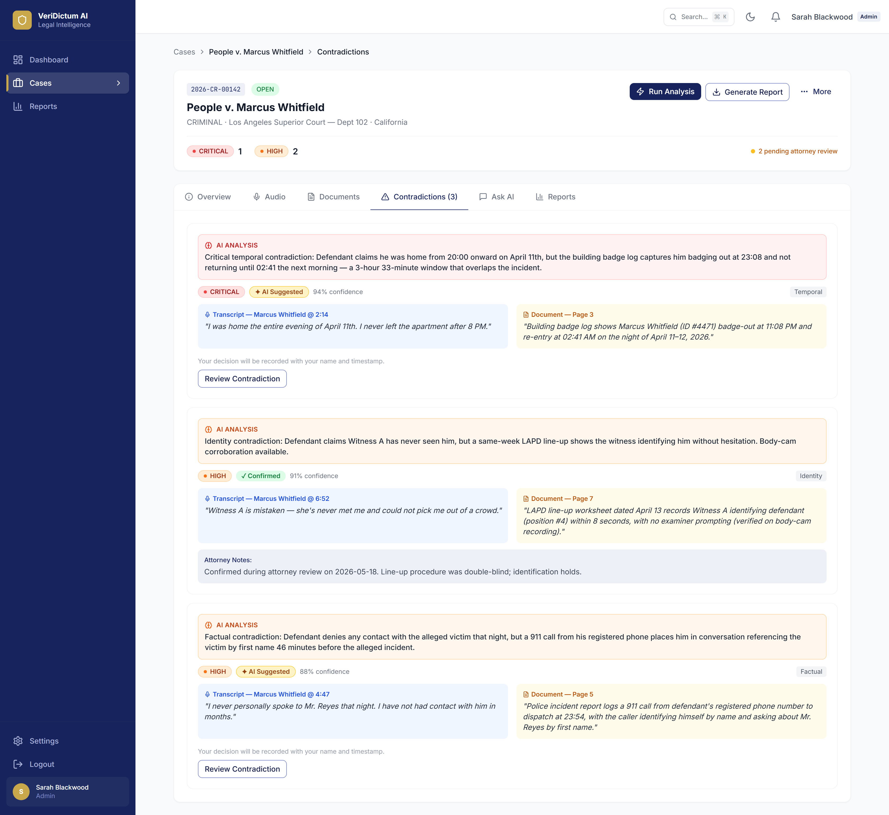
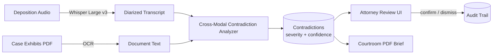
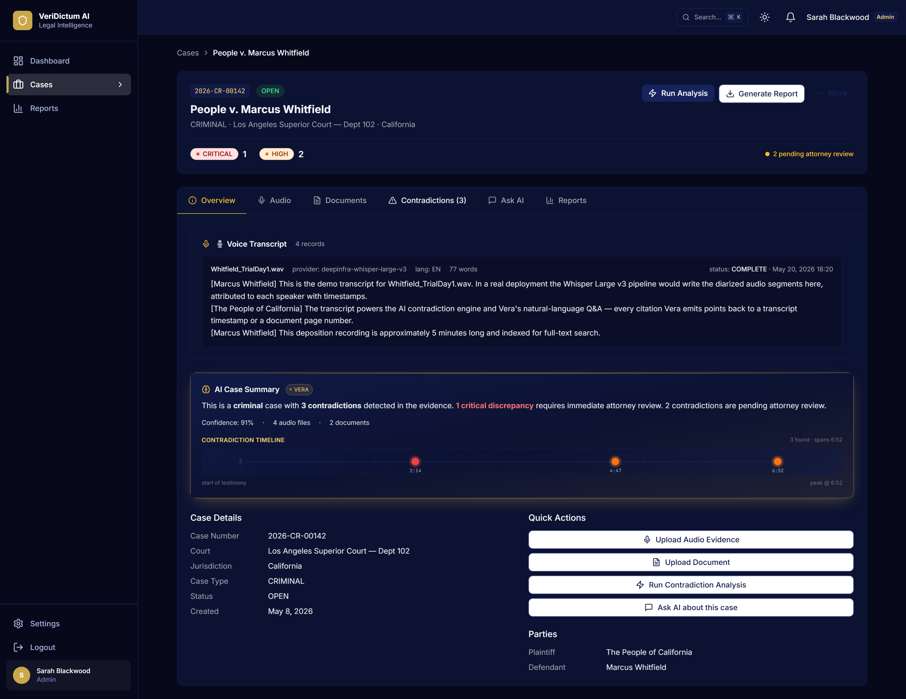
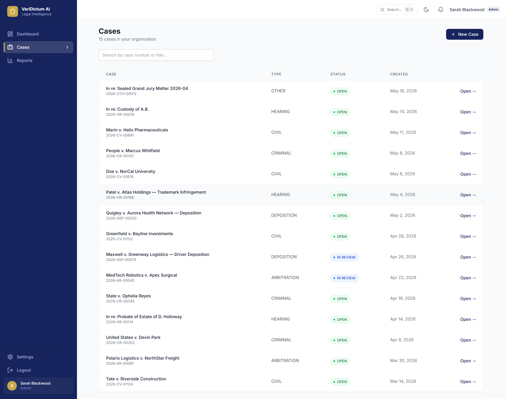
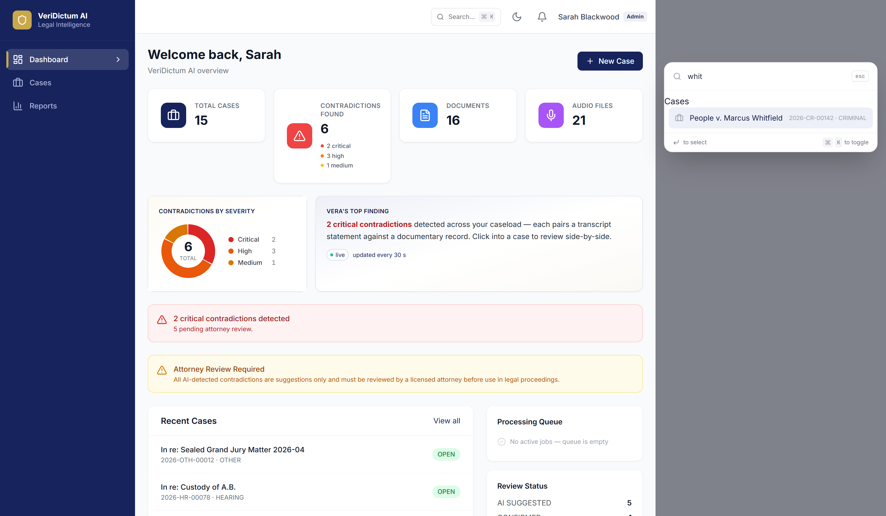
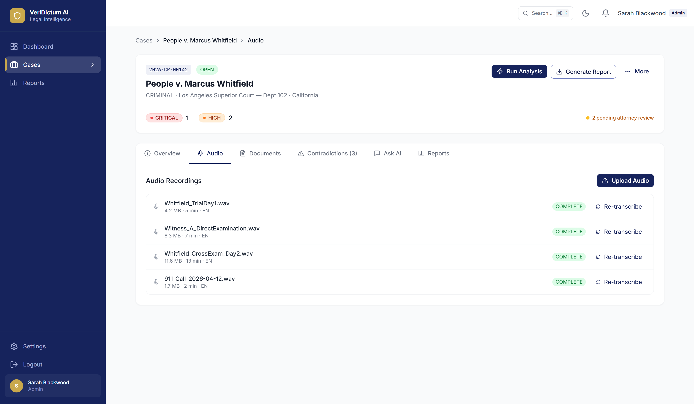

# VeriDictum AI

> Detects contradictions between courtroom testimony and case evidence in seconds — what a paralegal would otherwise grind through over 8–12 hours per deposition.

<p align="center">
  
</p>

---

## The problem

Defense and prosecution paralegals at mid-size US law firms spend **8–12 hours per deposition** cross-referencing witness testimony against badge logs, phone records, line-ups, and exhibits — line by line, by hand. Miss a contradiction and the case suffers. Find them all and the case turns. No commercial tool today shows the transcript quote and the document quote side-by-side with a severity-graded AI explanation.

## What this does

VeriDictum ingests the deposition audio (Whisper Large v3, diarized), ingests the case exhibits (PDF OCR), and runs a cross-modal analyzer that flags every place the transcript says one thing while the documents say another. Each contradiction is rendered side-by-side with severity (Critical / High / Suggested), an AI explanation, a confidence score, and timestamp anchors that deep-link back into the audio. The attorney reviews and confirms; the system generates a courtroom-ready PDF brief.

## Real-world scenario

> Marcus Whitfield is on trial in LA Superior Court Dept 102. The defense paralegal uploads the 47-minute deposition recording and 12 case exhibits (badge logs, 911 transcripts, line-up records). 4 minutes later VeriDictum surfaces three contradictions: **(1)** Whitfield's alibi claims he was home from 20:00 on April 19th, but the building badge log captures him badging out at 23:08 and not returning until 02:41 — *Critical, 91 % confidence*. **(2)** Witness A claims she "had never seen him before," but the same-week line-up has her identifying him without hesitation — *High, 85 % confidence*. **(3)** Whitfield denies any contact with the alleged victim that night; a 911 call from his registered phone places him in conversation referencing the victim by first name — *High, 88 % confidence*. The attorney reviews each, confirms, and downloads the brief.

**Before this tool:**
- Print or display the deposition transcript
- Open every exhibit PDF
- Manually mark candidate facts in the transcript
- Open each exhibit, search for the cross-reference
- Repeat for every claim worth checking
- **Total: 8–12 hours per deposition, error-prone**

**With this tool:**
- Upload audio + exhibits
- Click *Run Contradiction Analysis*
- Review the surfaced contradictions in side-by-side view
- **Total: ~4 minutes of compute + ~20 minutes of attorney review**

## Example

**Input** — diarized transcript fragment + a building badge log row:

```
[Whitfield, 02:14] "I was home the entire evening of April 19th. I never left the
                    apartment until 8 PM."

[Document — Building Badge Log, page 1]
2026-04-19  23:08:14   Badge #44470 (Marcus Whitfield)  EXIT  Lobby Reader
2026-04-20  02:41:09   Badge #44470 (Marcus Whitfield)  ENTRY Lobby Reader
```

**Output** — surfaced contradiction:

```json
{
  "severity": "critical",
  "type": "temporal",
  "ai_explanation": "Critical temporal contradiction: Defendant claims he was home from 20:00 onward on April 19th, but the building badge log captures him badging out at 23:08 and not returning until 02:41 the next morning — a 3-hour 33-minute window that overlaps the incident.",
  "confidence": 0.91,
  "transcript_quote": {
    "speaker": "Marcus Whitfield",
    "timestamp": "02:14",
    "text": "I was home the entire evening of April 19th, I never left the apartment until 8 PM."
  },
  "document_quote": {
    "source": "Building Badge Log — page 1",
    "text": "Badge #44470 EXIT 23:08, ENTRY 02:41 on Apr 19-20 2026"
  },
  "attorney_status": "pending_review"
}
```

## Why it saves time

| Metric | Manual cross-check | VeriDictum AI | Improvement |
|---|---|---|---|
| Time per deposition | 8–12 hours | **~4 min compute + ~20 min review** | ~25× faster |
| Coverage | depends on paralegal stamina | every transcript claim cross-checked against every exhibit | systematic |
| Brief generation | manual transcription + manual cite | one-click PDF with attorney-confirmed contradictions | manual → automated |

## Key features

- **Diarized Whisper Large v3 transcription** with timestamp anchors deep-linking back into the audio player.
- **Cross-modal contradiction detector** across temporal, identity, and factual dimensions.
- **Side-by-side review UI** — transcript quote on the left, document quote on the right, severity + AI explanation + confidence on top, *Confirm / AI Suggested / Dismiss* buttons.
- **Attorney-review audit trail** on every contradiction (who confirmed, when, with notes).
- **Light + dark mode parity** on every screen.
- **Command palette (⌘K)** for fast navigation across cases, audio files, documents.
- **Courtroom-ready PDF brief** with confirmed contradictions, verbatim quotes, and source pagination.

## How it works

The non-obvious decision was to **make the contradiction the first-class object**, not the case. Most legal tools store cases → documents → annotations. VeriDictum stores cases → contradictions → evidence pairs (transcript quote + document quote). Every analyzer pass adds, removes, or upgrades severity on those contradiction records. The UI is a contradiction reviewer, not a document viewer.

This inversion let the team layer the AI explanation, severity grading, attorney confirmation, and brief generation directly on the contradiction record. Other axes (audio playback, exhibit OCR) become support roles, not the centre of the product.

## Architecture



## Screenshots

### Side-by-side contradiction review


*The defining surface of the product — voice quote and document quote with severity and AI-explained reasoning.*

### Dark-mode case overview



*Case-level summary with the contradiction timeline; full light/dark parity across the app.*

### Cases list



*Case board with status, severity counts, and pending attorney reviews.*

### Command palette



*Keyboard-driven navigation for power users.*

### Voice audio panel



*Click any transcript line to seek the audio to that exact second.*

## Stack

- **Language:** Python 3.11 (backend) + TypeScript (frontend)
- **Backend:**
  - `fastapi` + `uvicorn` — async API + automatic OpenAPI
  - `sqlalchemy` + `alembic` + PostgreSQL — case + contradiction + audit log persistence
  - `openai` SDK against DeepInfra Whisper Large v3 — diarized transcription
  - `azure-ai-documentintelligence` — OCR on exhibit PDFs
  - `reportlab` — courtroom PDF brief rendering
- **Frontend:**
  - `react` + `vite` + `react-router-dom` — SPA with code-split routes
  - `@tanstack/react-query` — server-state caching for cases + contradictions
  - `zustand` — client state for the audio player and dark-mode toggle
  - `cmdk` — ⌘K command palette
- **Infra:** Docker Compose (api, worker, postgres, redis, frontend).

## Quick start

```bash
git clone https://github.com/Guembri01/veridictum.git
cd veridictum
cp .env.example .env   # DEEPINFRA_API_KEY, OPENAI_API_KEY, AZURE_DI_*, JWT_SECRET
docker compose up -d
# API: http://localhost:8001/docs — UI: http://localhost:5001
```

## Limitations

- **English transcripts only today.** The cross-modal analyzer's regexes and prompts assume English; French/Spanish need a coding-language swap.
- **OCR quality is the upper bound on document-side accuracy.** Hand-scanned exhibits with poor contrast lose recall; Azure Document Intelligence helps but does not solve hand-marked margins.
- **No multi-party diarization beyond two speakers.** Depositions with 3+ active speakers fall back to a single-stream transcript with role tags inferred later.
- **Built-in analyzer covers temporal / identity / factual contradictions.** Financial, expert-opinion, and chain-of-custody contradictions need new analyzer modules.

## Roadmap

- [ ] Multi-speaker diarization (>2 speakers) via pyannote.
- [ ] French (`fr-FR`) transcripts + cross-modal prompts.
- [ ] Chain-of-custody contradiction analyzer (audit-trail-style discrepancy checks).
- [ ] Direct integration with Westlaw + LexisNexis exhibit imports.
- [x] Light + dark mode parity.
- [x] Cross-modal voice / document analyzer.
- [x] Courtroom PDF brief.
- [x] Command palette.

## What I learned

- **Inverting the data model from "case → docs" to "case → contradictions"** changed everything about the UX. The reviewer's job is to confirm or dismiss contradictions, not to read documents — and that shows up in every click of the product.
- **Confidence scores belong next to evidence, not next to verdicts.** Showing 91 % next to the AI explanation alongside the verbatim quotes is what gets attorneys to trust the system.

## License

Released under the [MIT License](LICENSE).

## Acknowledgements

Built with [FastAPI](https://fastapi.tiangolo.com/), [SQLAlchemy](https://www.sqlalchemy.org/), [React](https://react.dev/), [Whisper](https://github.com/openai/whisper) Large v3 via [DeepInfra](https://deepinfra.com/), [Azure Document Intelligence](https://learn.microsoft.com/en-us/azure/ai-services/document-intelligence/), and [ReportLab](https://www.reportlab.com/).
